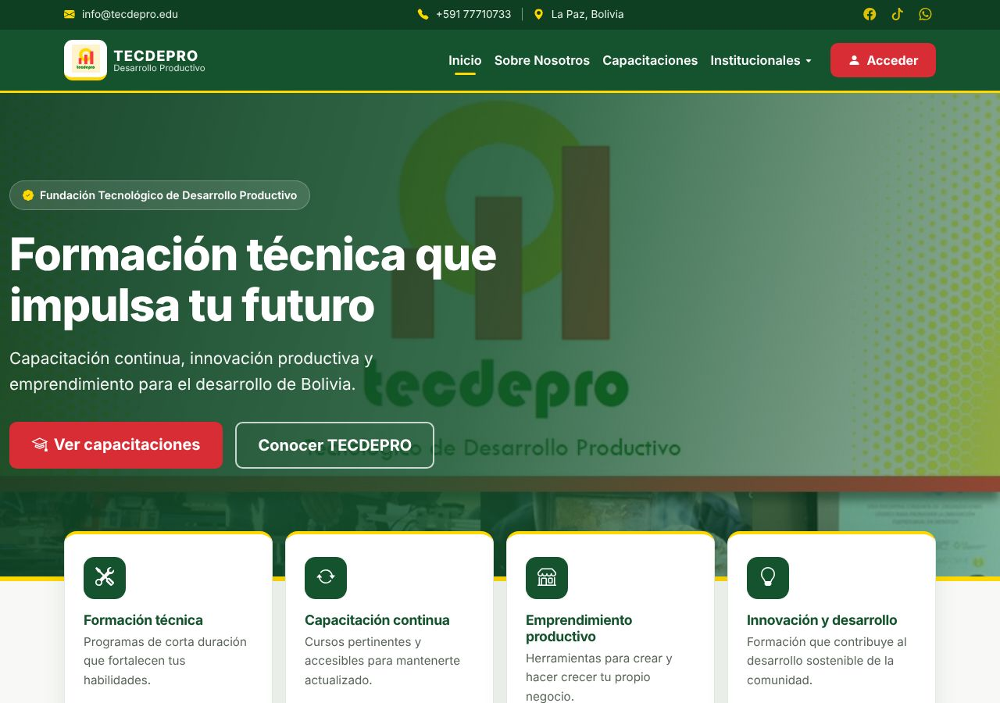
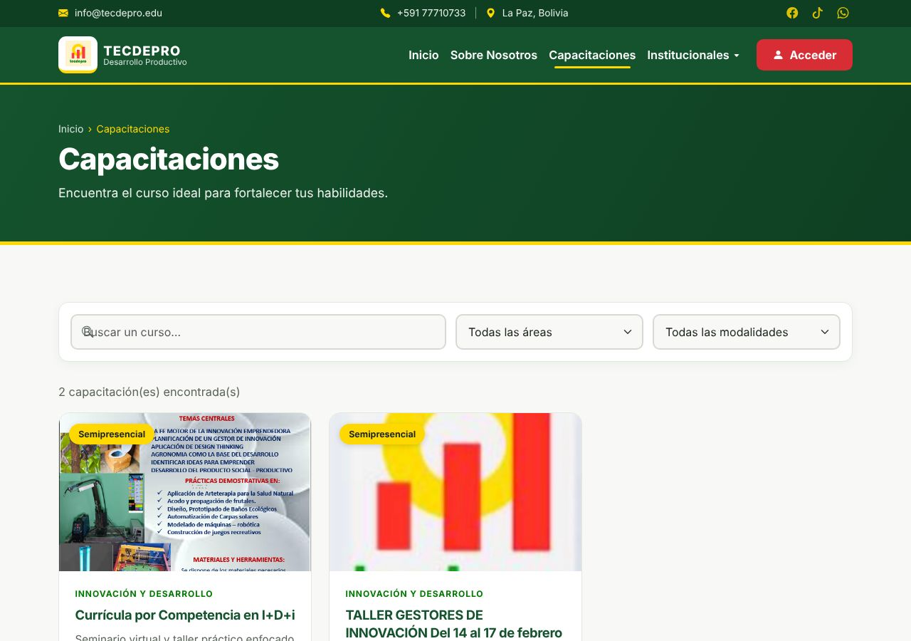
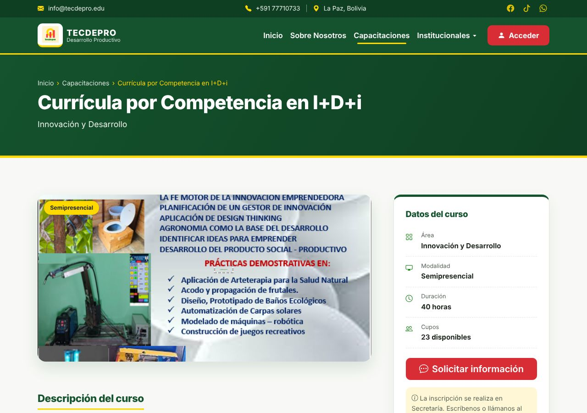
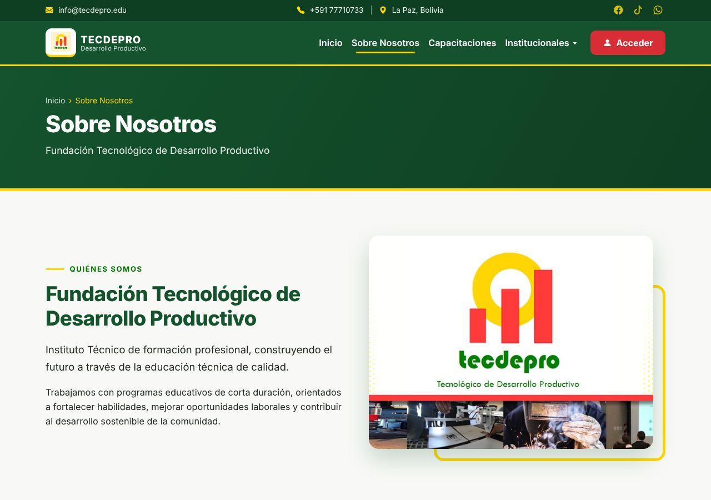
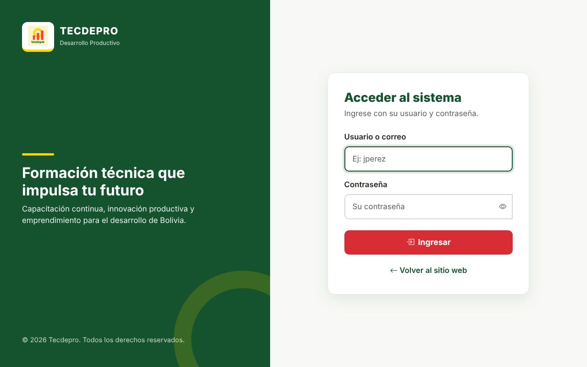
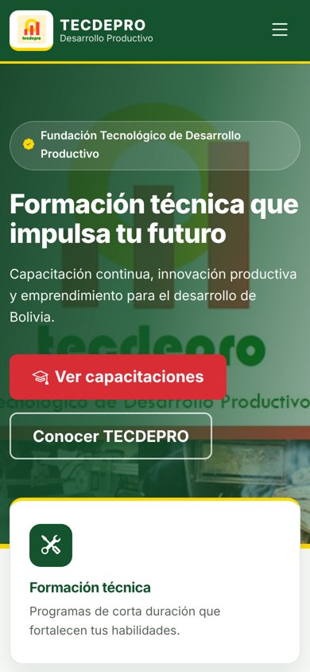

  

<h1 align="center">TECDEPRO</h1>

<b>Portal web y sistema de la Fundación Tecnológico de Desarrollo Productivo</b> La Paz, Bolivia

  
  

---

> 🔒 **El código fuente de este proyecto es privado.** Este repositorio solo muestra el trabajo realizado.
> Si quieres un sistema parecido para tu institución, [escríbeme](#-contacto).

## 📌 Sobre el proyecto

TECDEPRO es una fundación de La Paz que ofrece **cursos de capacitación técnica, formación continua y apoyo al emprendimiento productivo**.

Desarrollé su **portal web** y su **sistema interno**. El sitio está publicado en **[tecdepro.org](https://tecdepro.org)** y lo usan personas que buscan capacitarse.

## ✨ Funcionalidades

**Portal público**
- Página de inicio con las áreas de formación y los cursos disponibles
- **Catálogo de capacitaciones** con buscador y filtros por área y modalidad
- **Ficha de cada curso** con área, modalidad, duración, cupos disponibles y botón para pedir información
- Páginas institucionales: quiénes somos, misión y visión, noticias y contacto

**Sistema interno**
- **Acceso con usuario y contraseña** para el personal de la fundación
- Gestión de los cursos y de la información que se publica en el portal

**Calidad**
- Diseño adaptado a celulares, tablets y computadoras
- Se puede instalar en el celular como una app (PWA)
- Preparado para Google: datos estructurados, Open Graph y URLs amigables

## 📸 Capturas

| Catálogo de capacitaciones | Ficha del curso |
|---|---|
|  |  |

| Sobre nosotros | Acceso al sistema |
|---|---|
|  |  |

   
  <i>Versión para celular</i>

## 🛠️ Tecnologías

## 📫 Contacto

**Juan José Mamani Machaca**, desarrollador web y móvil en La Paz, Bolivia

- Portafolio: [jose011011.github.io](https://jose011011.github.io)
- Correo: [juanmamani121432@gmail.com](mailto:juanmamani121432@gmail.com)
- WhatsApp: [+591 64240837](https://wa.me/59164240837)

---
© 2026 Juan José Mamani Machaca. Todos los derechos reservados. Las capturas se muestran solo como portafolio.
